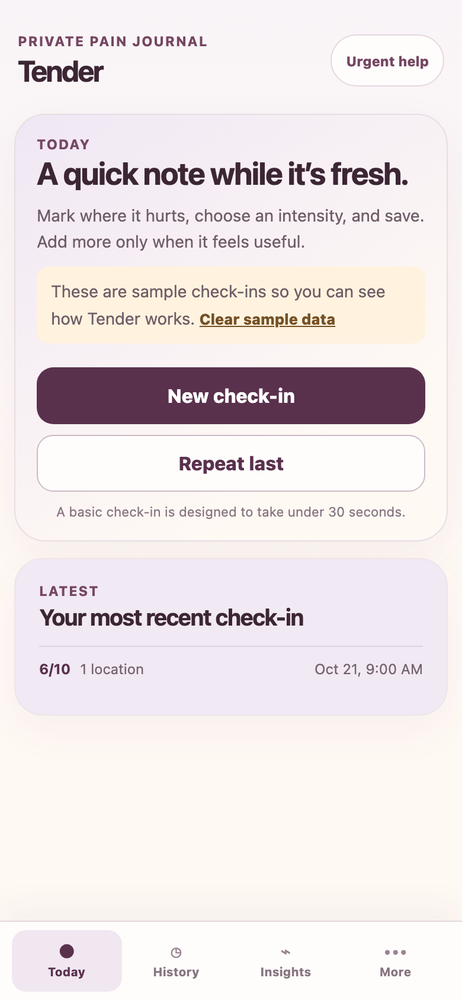
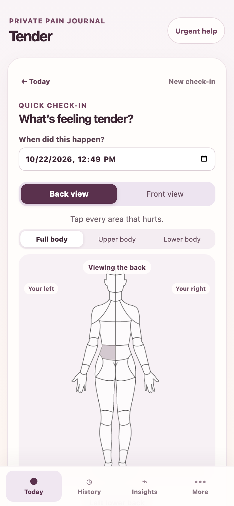
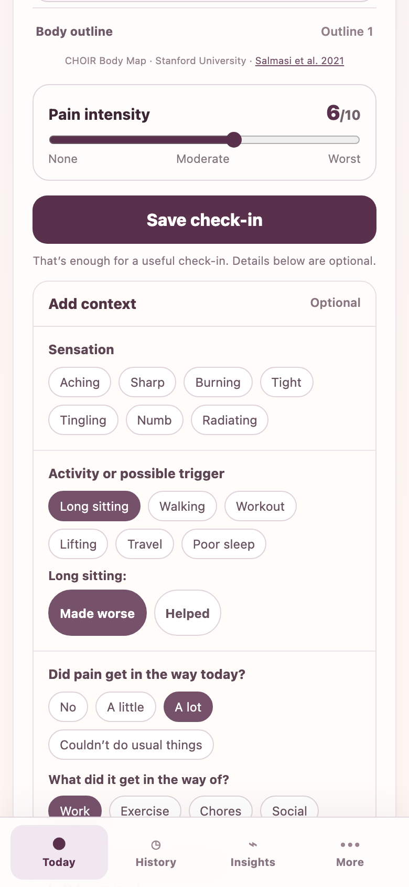
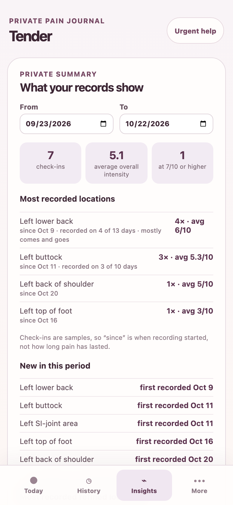

# Tender

**Live demo: https://tender-pain-journal.vercel.app**. It opens with sample check-ins, so nothing needs setting up.

Tender is a phone-first, local-first pain journal for people with long-running pain, built to make the next appointment better. A basic check-in (tap where it hurts on a body map, set an intensity, save) is designed to take under 30 seconds; sensations, activities, sleep, impact on the day, medication, and notes are optional and never in the way. Entries stay in the browser on the person's device. Insights and a plain-text appointment summary turn the record into something a clinician can read in a minute, and an optional, consent-gated AI narrative describes what stands out without diagnosing, triaging, or recommending treatment.

<p>
  
  
  
  
</p>

## A 90-second demo

The demo seeds seven sample check-ins on first visit (two weeks of lower-back and buttock pain), so every screen has something to show.

1. **Today (10 s).** The sample banner, your most recent check-in, and **Repeat last**.
2. **Check in (20 s).** Tap **New check-in**, tap the lower back on the body map, drag the intensity slider, then **Save check-in**. That's the whole basic path. Open **Add context** to see the optional fields: sensations, activities with your own made-worse / helped marker, "Did pain get in the way today?", steady or comes-and-goes, "Pain woke me", and medication.
3. **History (10 s).** Open a check-in to see everything it recorded, with edit and confirmed delete.
4. **Insights (30 s).** Most recorded locations with when recording started ("since … · recorded on 4 of 13 days"), areas new in the period, activity markers, days pain got in the way, and nights pain woke you. Tap **Download appointment summary** for the plain-text report.
5. **AI narrative (20 s).** At the bottom of Insights, open **What exactly is sent**, tick the consent box, and choose **Generate narrative**. Without a demo access code you get a clearly labeled, pre-written sample; **live AI is available on request**.

**Clear sample data** on Today removes the samples for good.

## Key product decisions

Each one is recorded in [`docs/decisions/`](docs/decisions/).

- **Local-first** ([ADR 0001](docs/decisions/0001-local-first.md)). Entries live in IndexedDB on the device. There are no accounts, no sync, and no analytics, and no health data is sent anywhere unless the person asks for an AI narrative. Backup is a JSON file the person downloads themselves.
- **Fast check-in first** ([ADR 0007](docs/decisions/0007-task-based-fast-checkin.md)). The basic path is four actions. Every addition lives inside a collapsed, optional section and stores nothing unless set. An end-to-end test guards the 30-second budget.
- **A visual body map, not anatomy names** ([ADR 0005](docs/decisions/0005-validated-body-map-foundation.md), [ADR 0006](docs/decisions/0006-tender-precision-layer.md)). It uses the validated 74-region CHOIR Body Map, plus an optional detail layer for SI-joint, hip, and glute areas.
- **Non-diagnostic.** Tender never diagnoses, triages, recommends treatment, or claims a cause. Insights describe co-occurrence ("recorded alongside"), and the person's own markers are labeled as theirs. Urgent-symptom guidance is always one tap away.
- **Consent-gated AI** ([ADR 0008](docs/decisions/0008-consent-gated-ai-narrative.md)). Nothing leaves the device until the person reads what will be sent and ticks a box for that one request. Insights and the appointment summary work fully without AI.
- **Payload minimization** ([ADR 0010](docs/decisions/0010-narrative-findings-payload.md)). The AI provider never sees diary records. Tender's server computes findings (trend, associations with counts, outliers, first-recorded labels, gaps, treatments, and notes with their dates) and sends only those. Times of day, record IDs, doses, per-area details, and the newer check-in fields are never sent. Fewer than 3 check-ins, or identical ones, get a fixed message with no AI call. The consent copy is generated from the same field lists the code sends, and a test fails if they drift apart.

## The AI narrative evaluation

The narrative had to earn its place, so before any change shipped it was measured against a fixed set of 16 synthetic fixtures (rising pain, a co-occurrence trap, prompt-injection notes, worrying notes, a dense month, and others), with 3 samples each. That gives 39 live narratives per run; 3 fixtures are deliberately gated.

- **Automatic hard checks** catch diagnosis, triage, causal or reassuring language, numbers or dates not in the record, left/right mix-ups, injection canaries, cut-off output, and (since v3) any question that judges a symptom.
- **Human rubric scores** (1–5, by the product owner) cover faithfulness, usefulness, coverage, co-occurrence framing, stated limits, and clinician readability.

| | Baseline (records sent as-is) | v2 (computed findings) |
| --- | --- | --- |
| Hard checks passed | 26 / 39 | 37 / 39; **39 / 39** in v2.1, v2.2 and v3 |
| Faithfulness | 5.0 | 5.0 |
| Usefulness | 3.45 | **3.91** |
| Clinician readability | 3.7 | **4.6** |
| Coverage | 4.64 | 4.27 (**−0.36**) |

Scores compare matched fixtures only: 11 for usefulness and coverage, 10 for the rest.

- **The coverage exception.** The rule allowed coverage to fall by at most 0.3. It fell by 0.36, mostly because the model now points out what stands out instead of restating every check-in, and because associations need at least 3 supporting check-ins. The product owner shipped anyway, with a dated, recorded exception: usefulness and readability rose, faithfulness held, and every hard check passed. Live AI also stays behind a demo access code.
- **v3 (this iteration)** adds findings aimed at what the coverage review found missing: which sensations were recorded with each medication, labels first recorded on the same day, and sensations that differ by body side. It also adds an optional "Questions this record raises" section (at most 2 questions, only about gaps in the data). v3 passed 39 of 39 hard checks. Its first run flagged one failure, which turned out to be a checker bug (a date read as a rating); the checker was fixed and the run repeated. v3 has not been rescored by hand.

The full method, results, and decisions are in [`docs/plans/narrative-eval.md`](docs/plans/narrative-eval.md) and [`docs/plans/narrative-v2.md`](docs/plans/narrative-v2.md). The harness is `npm run eval:narrative`.

## Architecture in brief

- **Client:** React and TypeScript, built with Vite as an installable PWA. Code is grouped by feature (`src/features/`: check-in, body map, entries, history, insights, reports, export, backup, ai-summary), and data goes through a small Dexie/IndexedDB layer validated by Zod (`src/shared/data/`).
- **AI server:** an optional Express app (`server/`) behind a provider-adapter interface, currently Anthropic and OpenAI, with the provider chosen at startup, never by a request. It validates the request, applies the pre-gates, computes findings, calls the provider, appends one limits sentence, and discards anything over 250 words or cut off.
- **Public demo:** Vercel serves the static app, plus two thin serverless wrappers (`api/`) around the same server logic. Generation requires a server-side demo passphrase; without it, visitors see the labeled sample.
- **Tests:** Vitest unit and component tests (`npm run check`, which also builds) and Playwright journeys on a Pixel 7 and a desktop browser (`npm run test:e2e`).

## How it was built with Claude Code

Tender was built by a product owner working with [Claude Code](https://claude.com/claude-code), with each step reviewed before the next.

- **A working agreement in [`CLAUDE.md`](CLAUDE.md)** holds the rules every session follows: the 30-second check-in, local-first storage, the non-diagnostic boundary, no API keys in the browser, and changing the consent copy, validation, tests, and ADR together whenever the AI payload changes.
- **Plans before code.** Features start as a written plan in [`docs/plans/`](docs/plans/), and implementation waits for the product owner's decisions on it. Lasting decisions become ADRs.
- **Evidence over assertion.** Every change runs `npm run check`, interaction changes run the Playwright journeys, and screens are reviewed at phone width. Live, billed AI eval runs happen only with explicit approval, and results (failures included) are written into the plan.
- **The human keeps the judgment calls**: rubric scores, the coverage exception, what notes may say, and whether a question crosses into triage.

## Run it locally

```bash
npm install
npm run dev          # local-only Tender
npm run check        # unit/component tests plus production build
npm run test:e2e     # Playwright journeys (mobile and desktop)
```

To try the AI narrative locally:

1. Copy `.env.example` to `.env.local`.
2. Set `TENDER_AI_PROVIDER` to `anthropic` or `openai`, and add your own key for it.
3. Run `npm run dev:ai`.

Never commit `.env.local`. Plain `npm run dev` stays local-only and exposes no key.

For the Vercel deployment, set the provider key, `TENDER_AI_PROVIDER`, and `TENDER_DEMO_PASSPHRASE` as server-side environment variables in the Vercel dashboard. They are never read from a file.

## Privacy boundary

- **No health data leaves the device by default.** Tender makes no network request with health entries unless the person generates an AI narrative.
- **Backups are local.** The app stores only the date of the last backup, on the same device, and never uploads a backup. People need to download backups themselves, because uninstalling or clearing browser data removes the journal.
- **The public site is the same local-first app.** One visitor never sees another's diary, because there are no accounts and nothing is stored on a server.

Tender's map is based on the CHOIR Body Map and keeps its source attribution (see [`THIRD_PARTY_NOTICES.md`](THIRD_PARTY_NOTICES.md)). That validates the location-reporting instrument, not Tender as a clinical product.
